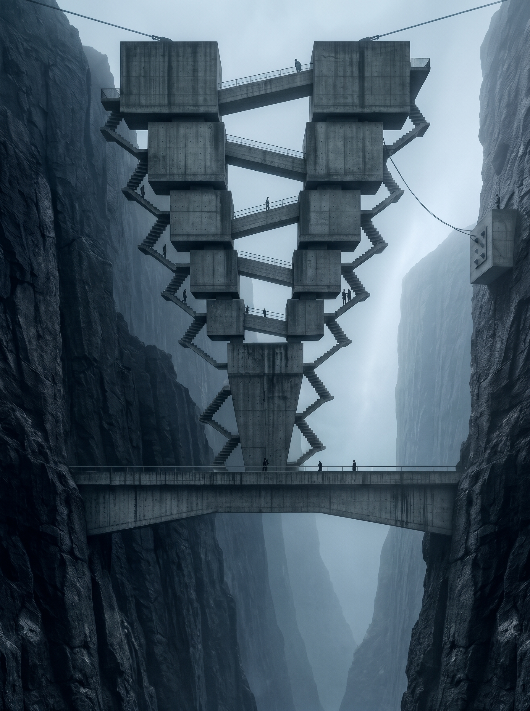
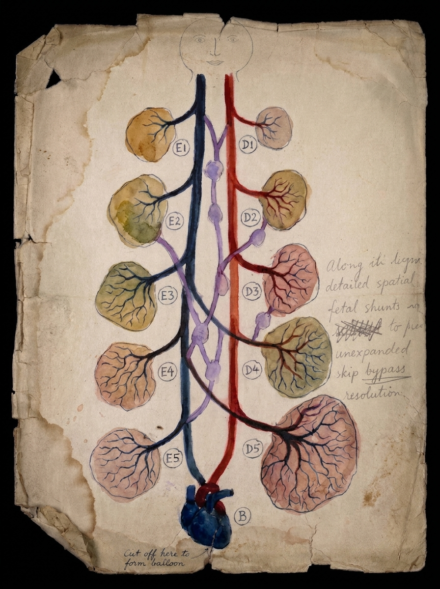

A [U-Net](https://arxiv.org/abs/1505.04597) has one of the most recognisable shapes in deep
learning. An encoder shrinks the image step by step, a bottleneck holds the most compressed
representation, a decoder grows it back to full resolution, and skip connections carry detail
straight across from one side to the other.

The three images below are artistic representations of that structure, generated with Gemini.

## brutalist unet

Five pairs of concrete blocks get smaller on the way down and meet in a single wedge, the
bottleneck. The two towers are the encoder and the decoder, and the bridges between them are the
skip connections.

## Circulation of a U-Net

This one is made to look like an old anatomical watercolour. Lobes E1 to E5 hang off a blue trunk,
D1 to D5 sit on the red side, and the two trunks meet at a heart labelled B. The purple vessels
crossing the middle play the skip connections. The wiring doesn't survive close inspection, since
D4 and D5 are fed from the blue trunk, but the margin note does manage to say "skip bypass".

## corset-unet

The most indirect of the three. Seven pairs of eyelets run down a V-shaped opening that narrows to
a single point, and the laces crossing the gap are the skip connections. The fourth pair is left
empty, like a skip connection nobody wired.
