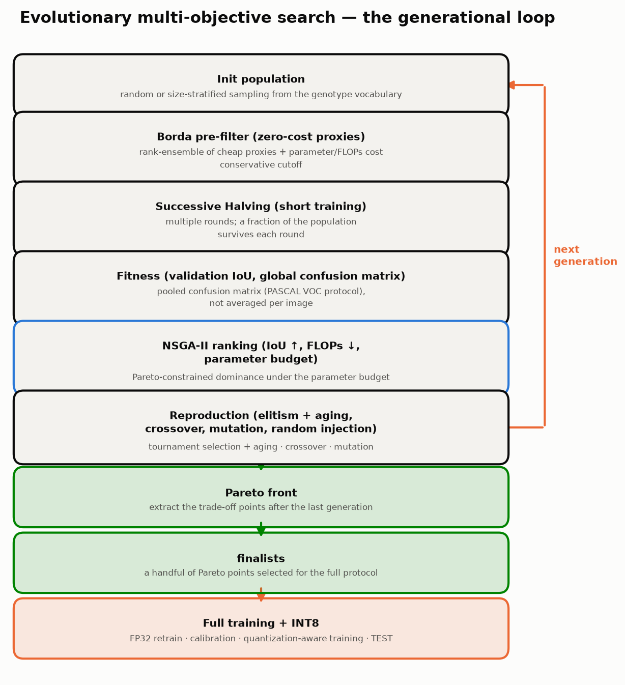
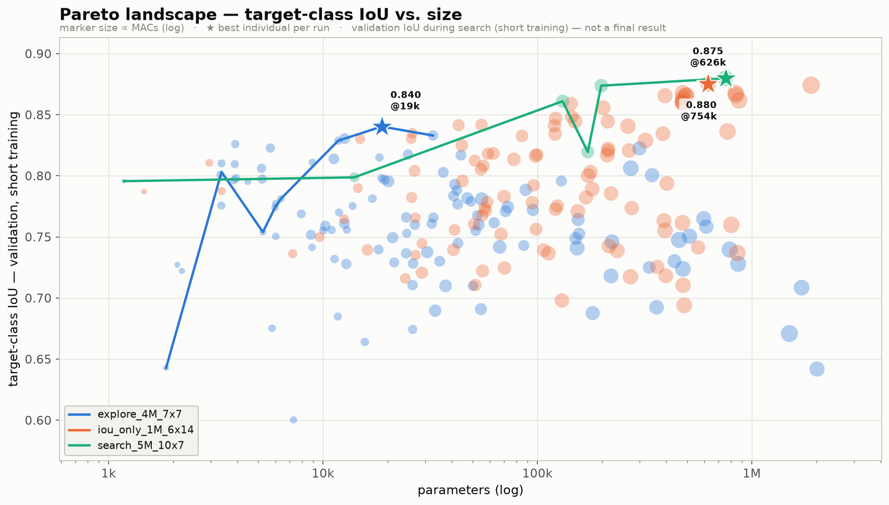
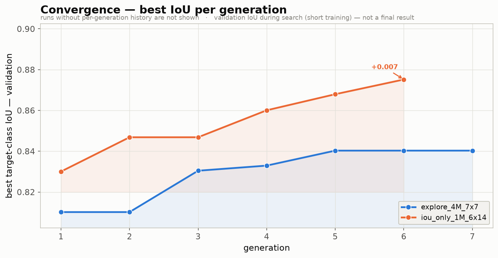
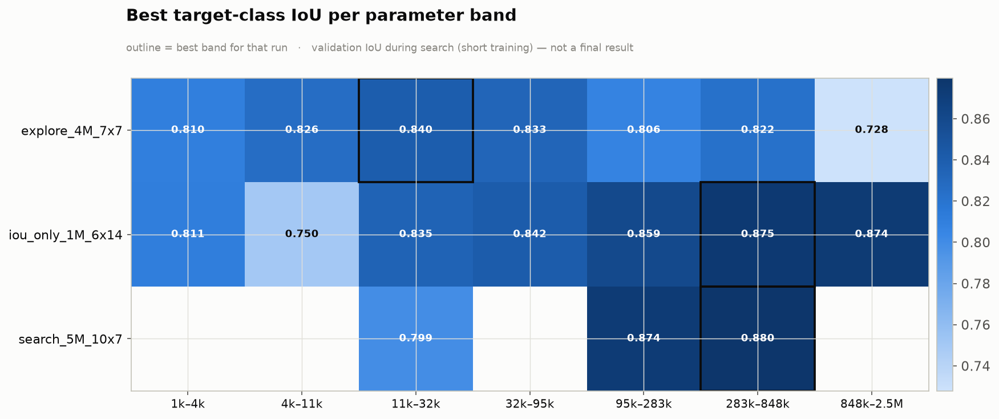
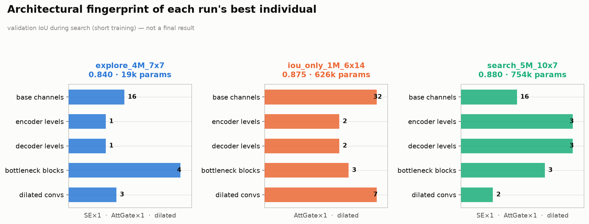
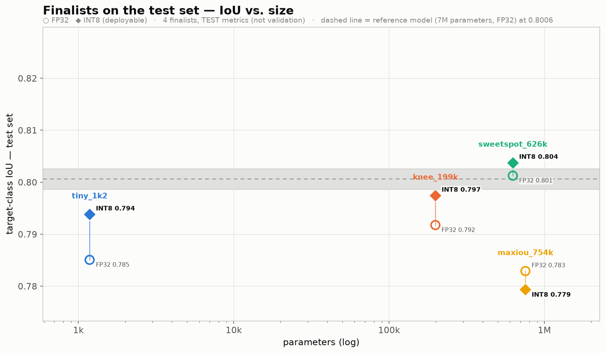
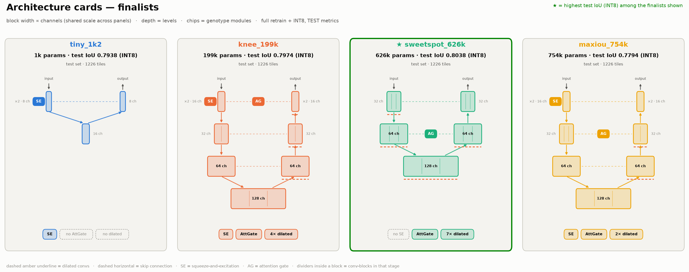

How small can a segmentation network be before it stops working? Not "how much can I prune this
ResNet", but: for a given task, a given sensor and an accuracy you are willing to accept, where is
the floor? On a satellite, a drone or any device that runs inference on a modest CPU the question is
not academic. The model has to fit a memory envelope, run in INT8, and often be uploaded through a
link measured in megabytes.

[MUTANT](https://github.com/ScrPzz/mutant) (Multi-objective UNet Tiny Architecture NAS Tool) is a
small tool I wrote to answer that question empirically. It searches U-Net-shaped architectures with
an evolutionary, multi-objective algorithm under a hard parameter budget, then trains the winners
from scratch and quantizes them to INT8. It is released under the MIT license.

This post has two parts. The first explains the logic of the tool, mechanism by mechanism, because
the interesting part of a NAS system is never the acronym but the dozen small decisions that make
the ranking signal trustworthy enough to select on. The second reports what happened when I pointed
it at a public flood-mapping benchmark. Those results are single-seed and preliminary, and I will
say so more than once.

## Part 1: the tool

### 1. The problem: segmentation under a budget, in INT8

Two constraints shape everything that follows.

The first is a **parameter budget**. The network must fit a tight memory and compute envelope, so
size is an objective to minimize, not a resource to spend. The usual NAS assumption, that a bigger
candidate is a safer default, is reversed.

The second is **INT8 inference**. The model that runs on the target is not the FP32 network the
search produces signal about but a quantized one, and quantization shifts both the accuracy and the
optimal decision threshold. The number that matters at the end is a calibrated INT8 metric on a
held-out test split, not a validation number from a large FP32 network.

MUTANT is deliberately narrow. The search space is a fixed vocabulary of convolutional blocks
arranged as a mirrored U-Net, the search loss is fixed, the two objectives (accuracy and cost) are
fixed. There is no weight sharing and no supernet: every candidate is a fresh `nn.Module`, trained
from random initialization for a short budget and then discarded. The tool is dataset-agnostic:
channels, classes, the class whose IoU matters and the tile size all come from a `dataset.json`.

### 2. Two phases, kept apart on purpose

| Phase | Goal | Budget per architecture | Command |
|---|---|---|---|
| Search | rank many architectures against each other | a few short-training epochs, staged by Successive Halving | `mutant search` |
| Full training | produce one deployable, calibrated, quantized model | up to 60 FP32 + 40 QAT epochs, early-stopped | `mutant train` |

The search fitness is cheap by design: the target-class IoU on the validation split after a handful
of epochs from a fresh initialization. Its job is to rank a population well enough for selection to
work, not to estimate what any candidate would reach if trained properly. A few epochs are a noisy
signal, and architectures get mis-ranked by short-lived optimization luck. The loop is built to
tolerate that noise rather than to trust the number: Successive Halving hedges the cost, aging
prevents fixation on individuals that got lucky once, and the final judgement is delegated to a
separate phase that trains the chosen genotypes for real. Search numbers and full-training numbers
are never presented as comparable, and the case study below has a concrete example of why: the best
individual on a search's validation front was the worst finalist on test.

### 3. Architectures as strings

Every architecture is a genotype with a lossless string form. This is the smallest finalist of the
case study, 1,182 parameters:

```
B8 E[+SE Cd3g Cd3rs] BN[Rc3r] D[Cd3rm]
```

`B<n>` is the base channel width; `E[...]`, `BN[...]` and `D[...]` are the encoder levels
(separated by `|`), the bottleneck and the decoder levels. The decoder always mirrors the encoder in
depth. Each block is a token from a vocabulary of 24, whose letters encode five properties:

| Position | Meaning |
|---|---|
| `Cs` / `Cd` / `Rc` | standard convolution / depthwise-separable convolution (MobileNet style) / residual block |
| `3` / `5` | kernel size |
| `r` / `g` | ReLU / GELU |
| `x` / `m` / `s` | channel multiplier 2.0 (expand) / 1.5 / 0.5 (shrink) |
| `d2` / `d4`, `n` | dilation 2 / 4; GroupNorm instead of BatchNorm |

Three architectural genes are markers at the start of the body they apply to: `+SE`
(squeeze-and-excitation on one encoder level), `+ASPP` (atrous spatial pyramid pooling on the
bottleneck) and `+AG` (an attention gate on one decoder level). A level without a marker simply has
the gene off. The decoder draws from a restricted pool (no channel expansion, fewer residual
variants) because the skip connections already inject context there. Depth is 1 to 3 levels, 1 to 3
blocks per level, base width in {8, 16, 24, 32, 48, 64}, and a hard cap of 256 channels anywhere.

Turning the string into a network is mechanical and channel-explicit: a stem projects the input to
the base width; each encoder level runs its blocks, applies SE if the gene is on, stores the skip
tensor and max-pools; the bottleneck runs its blocks and ASPP; each decoder level upsamples,
pads or crops to the skip's exact size, gates the skip if `+AG` is on, concatenates, projects with a
1×1 convolution and runs its blocks; a 1×1 head emits raw logits. Parsing is strict: an unknown
token, a misplaced marker or a depth mismatch raises instead of returning a half-valid genotype,
which is what makes the string a safe identifier to store in run files and pass to `mutant train`.

**Mutation** is single-point, one of three kinds chosen at random: replace one token, step the base
width to an adjacent value, or flip one gene. **Crossover** is variable-length: with parents of
depth \(a\) and \(b\), a cut point is drawn inside the common range \(L=\min(a,b)\), levels before
the cut come from the first parent and the rest from the second; levels beyond \(L\) come from the
deeper parent with probability 0.7; the bottleneck is always inherited from the first parent, the
base width and the ASPP flag are coin flips between the two. Depth itself is not mutated, so the
topology only changes through crossover.

### 4. The search loop



Every generation applies the same sequence to the population: a proxy pre-filter, Successive
Halving, the fitness evaluation, NSGA-II ranking, then aging, elitism and reproduction. Only
individuals that have never been evaluated go through the pre-filter and the training; elites
carried forward are re-evaluated on validation but never re-trained.

### Initialization

Plain random sampling of this grammar collapses toward small models: there are many more ways to
stay small than to reach the upper part of a budget. With `--stratified-init` the population is
over-sampled, bucketed into five log-spaced bins of estimated parameters up to the budget, and
filled round-robin from the largest bin down, so the first generation actually covers the range you
asked for. The estimate used here is a torch-free heuristic; the exact count is measured later and
enforced by the ranking, not at sampling time.

### Zero-cost proxies as a doorman, not a judge

Before anyone is trained, a Borda count over a few cheap signals drops the worst 30 % of the new
individuals: an expressivity proxy (NASWOT, the log-determinant of the Gram matrix of ReLU
activation patterns on one real batch, or a gradient-norm fallback for genotypes with GELU),
SynFlow, and the exact parameter count and estimated FLOPs. Each individual is ranked on each signal
and the ranks are summed; a missing signal costs a penalty rank.

The proxies never enter the fitness and never enter the objectives. On dense prediction their
correlation with accuracy is weakest exactly among the best candidates, which is the range a search
most needs to discriminate, and SynFlow behaves close to a parameter counter. Used as an admission
filter with a conservative drop fraction they mostly remove candidates that are also cost-dominated;
used as a score they would corrupt the selection.

### Successive Halving

The per-generation epoch budget is split in two rounds. Every survivor of the pre-filter trains from
scratch for half the budget; the best 60 % by validation IoU continue for the remaining epochs from
their own weights (a warm restart of the network, with a fresh optimizer and schedule). This spends
most of the compute on the candidates that are still in contention and makes the ranking less
sensitive to a bad first epoch. Training uses AdamW with cosine annealing, mixed precision on GPU
and gradient clipping; a batch with a non-finite loss is skipped.

### Fitness: one confusion matrix, one fixed loss

The fitness is the IoU of the target class on the validation split, computed from a single
confusion matrix accumulated over every tile of the split, with ignore pixels excluded:

$$\mathrm{IoU}_c = \frac{TP_c}{TP_c + FP_c + FN_c}$$

Averaging per-image IoUs instead would over-weight tiles where the class is small or absent; the
global matrix reports what fraction of the class's actual footprint the network gets right (the
PASCAL VOC protocol). One anti-inflation rule: if the target class never appears in ground truth or
prediction over the whole split, its IoU is forced to 0, so a network cannot score by never
predicting the class the search optimizes for.

The loss used inside every short training is a fixed Dice + Focal compound. It is not part of the
genotype and is never mutated. A loss's effect depends far more on the data (class imbalance,
boundary noise) than on the architecture; letting it vary per individual would add a second source
of variance to a signal that is already noisy, and candidates would stop being compared on a level
footing.

### NSGA-II with the budget as a constraint

Candidates are ranked with NSGA-II over two objectives, validation IoU to maximize and FLOPs to
minimize. The parameter budget is not a filter but a **constraint folded into dominance**: each
individual is mapped to a tuple that is minimized component-wise,

$$
\big(v,\; -\mathrm{IoU},\; \mathrm{FLOPs}\big), \qquad
v = \max(0,\, \#\text{params} - \text{budget}),
$$

where an infeasible individual gets \(v>0\) and \(+\infty\) on the other two axes. This reproduces
Deb's constrained-domination rules exactly: a feasible point dominates every infeasible one, two
infeasible points are ordered by violation, two feasible points compete on the plain Pareto
comparison. Rejecting oversized candidates outright would throw away the gradient information near
the boundary; dominance keeps the pressure toward small models without a hard wall. Fronts are
sorted by rank and, within a front, by crowding distance, which preserves the extremes and rewards
isolated points. A single-objective option drops FLOPs from the tuple and ranks on IoU alone under
the same budget; the third case-study run uses it.

### Reproduction: aging, hybrid elitism, tournament, injection

An elite may survive at most three generations before being retired, whatever its score
(regularized evolution: in a noisy few-epoch regime an individual that got lucky once must not
anchor the population). Elitism is hybrid: half of the elite slots go to the best scalar fitness
among feasible individuals, the other half to the NSGA-II order, which can keep a smaller, less
accurate network the scalar half would never pick. Parents are chosen by tournament (size 3) from
the non-failed individuals; crossover children are additionally mutated with probability 0.2;
three fresh random genotypes are injected every generation; duplicates by string are mutated a few
more times before being accepted. A candidate whose network cannot be built, trained or evaluated
(typically an out-of-memory error) becomes a "zombie" with IoU 0 and infinite FLOPs: it is logged,
dominated by everything, excluded from mating, and the run continues.

The output of a run is a JSON file with the configuration, the final Pareto front, the best
individual and the per-generation history. It is the only thing the search produces; no weights are
kept.

### 5. From a genotype to a deployable model

`mutant train` takes a genotype string and runs the protocol that produces the numbers you can
actually report.

**FP32.** From scratch, AdamW, learning rate halved on a plateau of the validation loss, early
stopping on the validation IoU of the target class with a long patience, gradient clipping. The
best checkpoint is reloaded at the end, so the phase always finishes on the best epoch.

**Calibration.** For two-class problems the network's scalar logit \(z\) for the target class is
collected over the validation split, and two numbers are fitted. A temperature \(T\) that minimizes
the binary cross-entropy of \(\sigma(z/T)\) against the labels (temperature scaling): a monotone
rescaling that does not change which threshold is IoU-optimal but de-saturates the probabilities so
that the threshold found next stays moderate and transferable from validation to test and from
FP32 to INT8. Then the threshold that maximizes the target IoU along the precision-recall curve,
clamped to \([0.01, 0.9]\) as a safety net against a saturated model whose "optimal" threshold would
collapse to one class everywhere. By default the calibration uses a seeded random subset of two
million validation pixels; the case study shows what that subset costs and how to use every pixel.

**Quantization-aware training.** The FP32 model is exported with `torch.export` (batch dimension
dynamic, spatial size fixed to the tile), fake-quantization nodes are inserted with the PyTorch 2
export flow of `torchao`, and the model is trained further at a small learning rate with cosine
annealing while the fake quantization simulates INT8 rounding in the forward pass. Observers are
frozen at 70 % of the epochs and batch-norm statistics at 80 %, then the graph is converted to real
INT8 operators and saved as an exported program. A state dict alone would not be enough: the
activation quantization parameters are constants of the graph.

**Test.** A fresh FP32 model is rebuilt from the genotype and loaded from the best checkpoint; the
INT8 program is loaded from disk; each of the two is recalibrated on its own on the validation
split and evaluated on the test split, with CPU latency and weight size. The independent
recalibration is why INT8 can come out slightly above FP32: not because quantization helps, but
because the operating point of each artifact is fitted separately.

### 6. Data in, artifacts out

A dataset is a directory with a `dataset.json` (channels, classes, target class, tile size,
normalization, split names) and one of two layouts: `tiles`, a folder of `.npz` files per split with
an `image [C,H,W]` and a `mask [H,W]` (class indexes, `-1` to ignore), or `geotiff`, whole scenes
tiled on the fly, with the bands to read, a label map or a small decoding function, an option to
pad the edge tiles so that every pixel is evaluated exactly once, and tile filters. The filters
matter more than they look: a minimum target-class fraction gives the training pool a class balance,
and the maximum ignore fraction can be set per split, so that filtering the training pool never
changes the validation and test sets you compare against.

The command line has five entry points, `search`, `train`, `eval`, `data` (check, stats, synth) and
`sync-mlflow`, all writing under the working directory or `MUTANT_OUTPUT_DIR`, all seeded. The
repository ships an executable quickstart notebook that runs the whole chain on synthetic data in
half a minute on a CPU, and the same chain is executed in CI on every push.

### 7. Design choices in one table

| Choice | Why |
|---|---|
| Two separate phases | Short trainings rank architectures; only full training produces results. Mixing them couples variables that must be analysed separately. |
| Proxies only as a pre-filter (≤ 30 %) | On dense prediction their correlation with accuracy is weak, especially among the best candidates. |
| Fixed search loss | The loss depends more on the data than on the architecture; co-searching it adds noise to the ranking. |
| Global confusion matrix | Per-image IoU averages are biased. |
| Budget as constrained dominance | Rejecting oversized candidates discards information near the boundary; dominance keeps the pressure toward small models. |
| Aging, hybrid elitism, variable-length crossover | Regularization against lucky individuals in a noisy regime; valid children between parents of different depth. |
| Per-model temperature and threshold | A monotone rescaling that makes the operating point transferable from validation to test and from FP32 to INT8. |
| INT8 through the export flow | The successor of FX graph-mode quantization; the converted model is persisted as a program because activation scales are graph constants. |

## Part 2: water segmentation on Sentinel-2

### 8. Task, data and the reference model

The benchmark is [WorldFloods v2](https://www.nature.com/articles/s41598-023-47595-7), Sentinel-2
L1C scenes of flood events with hand- and model-refined water masks, distributed through the
[ml4floods](https://github.com/spaceml-org/ml4floods) project: 475 training scenes, 16 validation
scenes, 18 test scenes. The models see six raw bands (B2, B3, B4, B8, B11, B12) on 512×512 tiles,
normalized per band; no spectral index is computed. Two classes, land and water, water being the
target; cloud and invalid pixels are ignored. Evaluation tiles are a regular grid with padded edge
tiles, 911 for validation and 1,226 for test, so that every pixel counts once.

The reference is the U-Net released with the dataset, about 7 M parameters, trained by its authors
on the same six bands. Evaluated with the same 1,226-tile protocol it reaches a water IoU of
**0.8006** in FP32. Other measurements of the same architecture under different training protocols
gave values between 0.799 and 0.804, so the band of ±0.005 around 0.80 is the resolution of every
comparison below.

### 9. Three searches (validation numbers)

All three runs share the same machinery: population 30, Successive Halving with keep fraction 0.6,
proxy drop 0.3, mutation 0.2, 4 elites, 3 random injections, elite age limit 3, Dice + Focal search
loss with a positive weight of 6 on water, batch size 16, seed 42, one GPU.

| Run | Budget | Generations × epochs | FLOPs objective | Stratified init | Best validation IoU @ parameters |
|---|---|---|---|---|---|
| `search_5M_10x7` | 5 M | 10 × 7 | yes | no | 0.8797 @ 754,436 |
| `explore_4M_7x7` | 4 M | 7 × 7 | yes | yes | 0.8403 @ 18,828 |
| `iou_only_1M_6x14` | 1 M | 6 × 14 | no | yes | 0.8752 @ 625,796 |









Three things are worth reading off these figures.

With seven epochs per individual, **small networks win**: the explore run's best point has 18.8 k
parameters. Doubling the epochs in the 1 M run moved the optimum to about 626 k parameters and
raised the best validation IoU from 0.840 to 0.875. Short-training fitness systematically
under-estimates large architectures, which is exactly why the verdict comes from the full
retraining below, not from these numbers.

Above roughly 600 k parameters the validation IoU stops improving within this vocabulary: the 754 k
genotype of the first run is not better than the 626 k one, and scaling the 626 k topology to 1.9 M
parameters did not help in a separate check. This is evidence about one family of architectures and
one epoch budget, not a general statement.

The first run was cut off in the log (its front was recovered from the terminal output, it has no
per-generation history) and the 1 M run was **stopped while still improving** (+0.007 on its last
generation): its best value is a lower bound, not a plateau.

### 10. Four finalists on the test split

Four genotypes were taken from the fronts: the extreme of compactness, the knee of the
IoU/parameters trade-off, the sweet spot of the 1 M run and the maximum-IoU individual of the first
run. Each was trained from scratch with the full protocol (Dice + weighted BCE, AdamW, up to 60
FP32 epochs with patience 22, batch size 8, no augmentation, then calibration and up to 40 QAT
epochs) and quantized to INT8. Metrics on the **test split**, 1,226 tiles:

| Finalist | Parameters | Epochs FP32 / QAT | Test IoU FP32 | Test IoU INT8 | INT8 mIoU | INT8 F1 (water) | INT8 threshold / temperature |
|---|---|---|---|---|---|---|---|
| `tiny_1k2` | 1,182 | 49 / 40 | 0.7851 | 0.7938 | 0.8509 | 0.8851 | 0.90 (cap) / 0.84 |
| `knee_199k` | 198,604 | 21 / 40 | 0.7918 | 0.7974 | 0.8537 | 0.8873 | 0.85 / 0.76 |
| `sweetspot_626k` | 625,796 | 28 / 26 | 0.8013 | 0.8038 | 0.8587 | 0.8912 | 0.89 / 0.93 |
| `maxiou_754k` | 754,436 | 38 / 17 | 0.7829 | 0.7794 | 0.8415 | 0.8760 | 0.83 / 0.78 |
| reference U-Net | ≈ 7 M | — | 0.8006 | — | — | — | — |





```
tiny_1k2        B8 E[+SE Cd3g Cd3rs] BN[Rc3r] D[Cd3rm]
knee_199k       B16 E[+SE Rc3g Cs3g | Cs3rx Cs5r | Rc3g] BN[Rc5r Rc3g Cs5r] D[Cd3rd2 | Cd3rd2 Cs3rd4 | +AG Cs3rd4 Rc3g]
sweetspot_626k  B32 E[Rc3rd2 Cs3r Cs3rx | Cs3rd2 Rc3rd2 Rc3rd4] BN[Rc3rd2 Cd5r Rc3rd4] D[+AG Cs3rd4 Cs5r Cd5r | Cd3g Cs3rm Cd5r]
maxiou_754k     B16 E[+SE Rc3g Cs3g | Cs3r Cs3rx Cd3rx | Rc3g] BN[Rc5r Rc3g Cs5r] D[Cd3rd2 | +AG Cs3r Cs3rd2 | Cs5r Rc3g]
```

What I take from this table, and what I do not:

- **A low capacity floor.** A network with 1,182 parameters reaches a water IoU of 0.79 on the test
  split. On this task the spectral separation of water is strong and most of the capacity of a 7 M
  U-Net is not needed. This is a statement of existence (the floor is low), not of saturation: the
  trend from 1 k to 626 k parameters is still upward.
- **The 626 k finalist matches the reference** within the ±0.005 resolution of the comparison, with
  about 11× fewer parameters. It is the only finalist above 0.80 in both precisions. I do not claim it
  beats the reference: 0.8038 versus 0.8006 is inside the band.
- **Validation optimism.** `maxiou_754k`, the best individual of the first search on validation, is
  the worst finalist on test. Short-training validation numbers rank architectures; they do not
  predict final accuracy.
- **INT8 above FP32 for three finalists.** The gain, +0.003 to +0.009, comes from recalibrating each
  artifact on the validation split, not from quantization, and it is within what a single seed can
  produce.
- **The smallest network is at the edge of its calibration range.** The optimal threshold of
  `tiny_1k2` hit the cap of 0.9: its probabilities are saturated.
- **Precision above recall.** For all four finalists the FP32 test precision is 0.92 to 0.93 and the
  recall 0.83 to 0.85. The models under-segment water, which matters for flood mapping and is
  invisible in the IoU.

### 11. What the released code reproduces

The finalists were trained with an earlier, internal version of the pipeline, so I checked what the
released code reproduces before writing any of the above.

The public GeoTIFF adapter, with the `dataset.json` given in the repository's case-study document,
produces the same 911 validation and 1,226 test tiles as the original evaluation code, with
bit-identical tensors for full and padded edge tiles.

`mutant eval` on the original FP32 checkpoints of the four finalists reproduces the FP32 test
metrics of the table above to four decimals (IoU, mIoU, F1, precision, recall, threshold and
temperature) when the calibration uses every valid validation pixel, about 2.4·10⁸ of them, which
needs some 10 GB of RAM and one minute. With the default two-million-pixel subset the calibrated
operating point moves slightly and the test IoU changes by up to ±0.0013 (0.7860, 0.7917, 0.8024 and
0.7816 for the four finalists). That is small, but it is the same order as some of the differences
between finalists, which is the honest way to say that differences of that size should not be read
as architecture.

The INT8 numbers are the one thing the released code does not reproduce bit for bit: they were
produced with an in-tree PyTorch 2.10 quantization flow and an XNNPACK quantizer that later PyTorch
versions no longer ship. MUTANT uses the successor of that flow in `torchao` with an x86 quantizer,
so INT8 results from the released code are comparable in spirit, not in bits.

*A from-scratch reproduction of `sweetspot_626k` with the released code (grid training pool without
water-centred tiles, INT8 through `torchao`) is running while this post goes out; its FP32 and INT8
test numbers will be added here as soon as it finishes.*

### 12. Limitations

- Single seed per search and per finalist, no confidence intervals. Differences below ±0.01 IoU
  between finalists should not be interpreted.
- No random-search baseline at equal compute: the benefit of the evolutionary machinery over random
  sampling is not quantified.
- The reference model is a released pretrained network, not a model trained with the finalists'
  protocol. The comparison is between deployable artifacts, not between training recipes.
- The 1 M search was interrupted while improving and the first search has no history.
- Validation and test scenes come from the same distribution of flood events; generalization to
  other regions, seasons or sensors was not evaluated.
- The training tile pool of the original runs contained water-centred tiles that the public adapter
  does not generate; a reproduction from scratch with the released code is expected to land close
  to, not exactly on, the numbers above.

### 13. Try it

```bash
git clone https://github.com/ScrPzz/mutant.git && cd mutant
python -m venv .venv && source .venv/bin/activate
pip install torch --index-url https://download.pytorch.org/whl/cpu   # or a CUDA wheel
pip install -e ".[dev]"
mutant search --smoke                        # a real but minimal search on synthetic data, seconds on CPU
mutant data synth ./demo --in-channels 4 --num-classes 2 --tile-size 64
mutant search --data ./demo --smoke
mutant train --data ./demo --genotype "B8 E[+SE Cd3g Cd3rs] BN[Rc3r] D[Cd3rm]" --smoke
```

The repository has eight documents (overview, search space, algorithm, data, training and INT8, the
case study with the exact `dataset.json` and commands, reproducibility, API), an executable
quickstart notebook, the three search runs and the four finalists as JSON, and the scripts that
regenerate every figure in this post. Issues and pull requests are welcome, and so is anyone who
runs it on a different dataset and tells me where the floor is there.

## References

- Deb, K., Pratap, A., Agarwal, S., Meyarivan, T. (2002). A fast and elitist multiobjective genetic algorithm: NSGA-II. *IEEE Transactions on Evolutionary Computation* 6(2).
- Deb, K. (2000). An efficient constraint handling method for genetic algorithms. *Computer Methods in Applied Mechanics and Engineering* 186.
- Real, E., Aggarwal, A., Huang, Y., Le, Q. V. (2019). Regularized evolution for image classifier architecture search. *AAAI*.
- Li, L., Jamieson, K., DeSalvo, G., Rostamizadeh, A., Talwalkar, A. (2018). Hyperband: a novel bandit-based approach to hyperparameter optimization. *JMLR* 18.
- Mellor, J., Turner, J., Storkey, A., Crowley, E. J. (2021). Neural architecture search without training. *ICML*.
- Abdelfattah, M. S., Mehrotra, A., Dudziak, Ł., Lane, N. D. (2021). Zero-cost proxies for lightweight NAS. *ICLR*.
- Tanaka, H., Kunin, D., Yamins, D. L. K., Ganguli, S. (2020). Pruning neural networks without any data by iteratively conserving synaptic flow. *NeurIPS*.
- Krishnakumar, A., White, C., Zela, A., Tu, R., Safari, M., Hutter, F. (2022). NAS-Bench-Suite-Zero: accelerating research on zero cost proxies for neural architecture search. *NeurIPS Datasets and Benchmarks*.
- Ning, X., et al. (2021). Evaluating efficient performance estimators of neural architectures. *NeurIPS*.
- Everingham, M., Van Gool, L., Williams, C. K. I., Winn, J., Zisserman, A. (2010). The PASCAL Visual Object Classes (VOC) Challenge. *IJCV* 88(2).
- Guo, C., Pleiss, G., Sun, Y., Weinberger, K. Q. (2017). On calibration of modern neural networks. *ICML*.
- Lin, T.-Y., Goyal, P., Girshick, R., He, K., Dollár, P. (2017). Focal loss for dense object detection. *ICCV*.
- Milletari, F., Navab, N., Ahmadi, S.-A. (2016). V-Net: fully convolutional neural networks for volumetric medical image segmentation. *3DV*.
- Howard, A. G., et al. (2017). MobileNets: efficient convolutional neural networks for mobile vision applications. *arXiv:1704.04861*.
- Hu, J., Shen, L., Sun, G. (2018). Squeeze-and-excitation networks. *CVPR*.
- Chen, L.-C., Papandreou, G., Kokkinos, I., Murphy, K., Yuille, A. L. (2018). DeepLab: semantic image segmentation with deep convolutional nets, atrous convolution, and fully connected CRFs. *TPAMI* 40(4).
- Oktay, O., et al. (2018). Attention U-Net: learning where to look for the pancreas. *MIDL*.
- Portales-Juliá, E., Mateo-García, G., Purcell, C., Gómez-Chova, L. (2023). Global flood extent segmentation in optical satellite images. *Scientific Reports* 13, 20316.
- Mateo-García, G., Veitch-Michaelis, J., Smith, L., et al. (2021). Towards global flood mapping onboard low cost satellites with machine learning. *Scientific Reports* 11, 7249.
- Del Prete, R., et al. (2025). Optimizing deep learning models for on-orbit deployment through neural architecture search. *Scientific Reports* 15, 37783.
- Wei, J., Fan, Z., et al. (2021). Genetic U-Net: automatically designed deep networks for retinal vessel segmentation using a genetic algorithm. *IEEE Transactions on Medical Imaging* 41(2).
